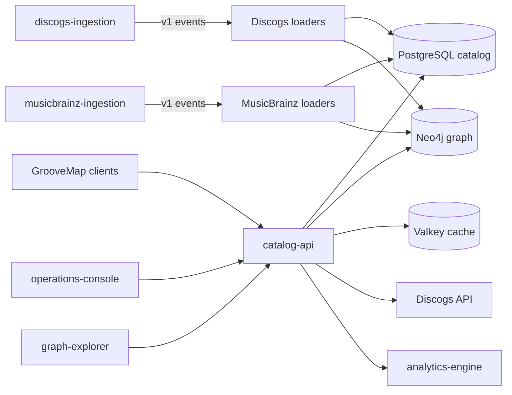

# GrooveMap catalog API

The FastAPI service behind GrooveMap. It owns authentication, Discogs OAuth and
synchronization, catalog search, graph queries, recommendations, natural-language queries,
internal analytics endpoints, and operator setup CLIs.

This README is for developers and maintainers of this repository. Operators should start
with the [documentation index](docs/README.md); API consumers should start with the
[API service guide](api/README.md).



## Quick start

You need [mise](https://mise.jdx.dev/). Docker is needed only for `just image` and the
integration recipes. `mise install` pins Python, `uv`, `just`, and `gitleaks`.

```bash
mise install    # toolchain from .mise.toml
just setup      # install locked dependencies with uv
just check      # the full pre-merge gate
```

`just check` uses fakes and needs no running databases. The integration recipes
(`just test-integration`, `just integration-valkey`) start their own throwaway containers
instead.

### Run the service

The service needs reachable PostgreSQL, Neo4j, and Valkey instances. The Compose stack in the
[`deployment` repository](https://github.com/groovemap-music/deployment) provides them. Export
the required settings from the
[minimal local example](docs/configuration.md#minimal-local-example), then start the service:

```bash
uv run python -m api.api    # or the installed equivalent: catalog-api
```

Deployment notes: PgBouncer in front of PostgreSQL must use **session** pool mode (the automatic
re-attachment trigger holds a session-level advisory lock), the runtime role needs no superuser,
and every Valkey key is namespaced with `VALKEY_KEY_PREFIX` (default `groovemap:`) so a Valkey
can be shared. Upgrading a stack that already holds unprefixed keys is safe by default
(`VALKEY_LEGACY_KEYS=read` keeps revoked tokens revoked; `migrate` is the explicit dedicated-stack opt-in). See [PostgreSQL pooling and role
privileges](docs/configuration.md#postgresql-pooling-and-role-privileges) and [Valkey database,
key namespace and upgrading an existing stack](docs/configuration.md#valkey-database-key-namespace-and-upgrading-an-existing-stack).

The API listens on port 8004. A separate health server listens on port 8005:

```bash
curl http://localhost:8005/health
```

## Command-line tools

The wheel installs these commands. Each is documented in the
[API service guide](api/README.md#operator-setup) or the
[administration guide](docs/admin-guide.md).

| Command | Purpose |
| --- | --- |
| `catalog-api` | Start the API service (the container entry point) |
| `catalog-setup` | Store the Discogs application credentials |
| `catalog-admin-setup` | Create, list, or update administrator accounts |
| `catalog-media-backfill` | Backfill `media` on synced collections and wantlists |
| `catalog-identity-projection` | Project `gm_id` onto Neo4j nodes |
| `catalog-identity-reattach` | Re-attach load-order-split catalog items |
| `catalog-identity-ledger-backfill` | Backfill the Identity Ledger from the MusicBrainz full export |

## Development

**Public-library cutover: complete.** This service consumes `groovemap-runtime` and
`groovemap-agent-tools` from the public `groovemap-music/python-libraries` repository at the
reviewed revision recorded in the lockfile. Local setup and CI do not require private-package
credentials.

```bash
mise install
just setup
just check
just image
```

`just check` is the authoritative pre-merge gate. It uses fakes and mocks for external
systems. Live integration, load, and deployment checks are deliberately separate. The
performance runner is owned here, while deployment owns its environment and orchestration.
Use `just --summary` to list the complete recipe surface. `just format-check`, `just lint`,
`just contract-check`, `just test`, and `just coverage` provide focused feedback;
`just secret-scan` and `just audit` are separate policy capabilities. `just image`,
`just performance-image`, and `just release-dry-run` build or rehearse locally and never
publish. The repository-owned [coverage policy](docs/coverage-policy.md) records and enforces
the measured floor used by both local checks and CI.

`just test-integration` starts disposable PostgreSQL and Neo4j containers on random
loopback ports, runs the engine-backed query and collection-write regressions, and removes
both containers on exit. It requires a running Docker engine and never targets configured
development or production databases. It applies the pinned `database-schema` DDL and covers the
historical credits-query grouping failure, collection-upsert preservation, query-helper result
handling, invalid Cypher, a real server-side query timeout, catalog re-attachment and its
automatic watcher, the Identity Ledger backfill and routes, barcode lookup, and the precomputed
similar-artist reads. Pull-request CI supplies this command as the repository's separate
integration lane; `just check` remains network-free.

`just integration-rarity-neo4j` is a separate opt-in check. It starts a disposable Neo4j
container to test the rarity zero-master sentinels.

`just integration-valkey` is a separate opt-in check. It starts the production-pinned Valkey
with a tiny `maxmemory` under `noeviction`, plus PostgreSQL, both as throwaway loopback
containers. It fills Valkey and then exercises every write-rejection path against them: the
503 mapping, the password-change rollback, the snapshot quota and the sync lock. It skips
cleanly without Docker. See
[docs/valkey-noeviction-verification.md](docs/valkey-noeviction-verification.md).

Pull requests, pushes to `main`, the weekly schedule, and Dependabot pull requests all use
the same required validation graph from the public `groovemap-music/automation` repository.
The public Python-library source is pinned at an immutable revision and requires no GitHub App
credential. A cross-repository PAT and a reduced dependency-update gate are both rejected.

## Observability

The service pushes OpenTelemetry metrics and traces over OTLP HTTP/protobuf and never
exposes a Prometheus scrape endpoint of its own. It reads only the standard OpenTelemetry
environment variables; with `OTEL_EXPORTER_OTLP_ENDPOINT` unset it installs a no-op meter
provider and a no-op tracer provider and behaves exactly as it did before.

The service records HTTP, database, cache, sync, NLQ, activity, and Identity Ledger refresh
metrics. It also reports the process view and event-loop lag that `groovemap-runtime`
installs, and it opens two domain root spans of its own: `api.sync` for a Discogs collection
and wantlist sync, and `api.nlq` for a natural-language query. Request, outbound-HTTP, and
database spans come from the instrumentations and the shared resilient wrappers. The
[configuration guide](docs/configuration.md#opentelemetry-metrics-and-traces) lists the
variables, the metrics, and the spans.

## Contracts

- Catalog events are promoted independently from
  [`discogs-ingestion`](https://github.com/groovemap-music/discogs-ingestion) and
  [`musicbrainz-ingestion`](https://github.com/groovemap-music/musicbrainz-ingestion) and
  verified by digest.
- Persistence compatibility is promoted from `database-schema` and pins the tested runtime.
- The internal Analytics OpenAPI document and generated consumer binding are owned in
  `api/contracts/internal-insights/v1/`; downstream consumers promote the artifact rather
  than this repository writing across a boundary.

## Release and license

This repository versions one service wheel and its two container images, `catalog-api`
and `catalog-api-performance`. Commitizen reads the PEP 621 version and uses annotated
`v$version` tags. `just release-dry-run` creates local checksums, an SBOM, notices, and
provenance without tagging, pushing, publishing, or releasing.

The current tree is licensed under the [GNU Affero General Public License v3 only](LICENSE).
The AGPL permits commercial use when its terms are followed; commercial use by itself does
not require a separate license. Copyright holders may negotiate optional alternative terms
with parties that do not want to use the software under the AGPL; see
[commercial licensing](COMMERCIAL-LICENSING.md). [NOTICE](NOTICE) records prior-license
history.

The container build injects its full Git revision into the service. The generated
`/openapi.json`, `/docs`, and `/redoc` metadata link to the corresponding source tree
for that exact revision.

External code and documentation contributions are paused until the project adopts a
relicensing-capable contributor license agreement. See [CONTRIBUTING.md](CONTRIBUTING.md).

## Documentation

See the [documentation index](docs/README.md) for configuration, administration,
performance, examples, architecture decisions, and release-compliance gates.
