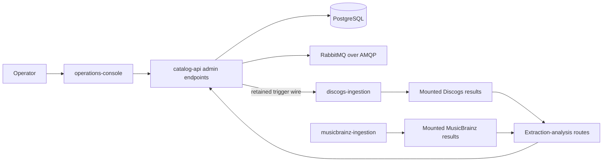

# catalog-api administration

This guide documents the administrative API and command-line tools owned by `catalog-api`.
The operator UI is owned by
[`operations-console`](https://github.com/groovemap-music/operations-console), while container
execution and production topology are owned by
[`deployment`](https://github.com/groovemap-music/deployment).



## Bootstrap an administrator

The packaged `catalog-admin-setup` command creates, lists, or updates administrators in
PostgreSQL. It never accepts a password as a command-line argument. Interactive use prompts
without echo; automation must supply `ADMIN_PASSWORD` or `ADMIN_PASSWORD_FILE`.

```bash
catalog-admin-setup --email admin@example.com
catalog-admin-setup --list
```

Passwords must contain at least eight characters. Running the create command for an existing
email updates its password. The exact container invocation belongs in the deployment runbook.

## Authentication and audit

All administrative endpoints except login require an administrator bearer token.

| Method | Path | Responsibility |
| --- | --- | --- |
| `POST` | `/api/admin/auth/login` | Create an administrator session |
| `POST` | `/api/admin/auth/logout` | Revoke the current session |
| `GET` | `/api/admin/auth/session` | Validate the current session; returns `admin_id`, `email`, `expires_at` |
| `GET` | `/api/admin/audit-log` | Read the paginated 90-day audit window |
| `GET` | `/api/admin/users/stats` | Aggregate account statistics |
| `GET` | `/api/admin/users/sync-activity` | Recent user synchronization activity |
| `GET` | `/api/admin/storage` | Catalog storage summaries |

Authentication failures do not log email addresses or secrets. Administrative mutations append
an audit entry with the actor, action, target, and non-secret details.

## Extraction control and analysis

`POST /api/admin/extractions/trigger` takes a required body `{"source": "discogs" | "musicbrainz"}`,
records a pending run, calls the trigger of that source's own producer, and tracks progress
through that producer's health contract. A missing or unknown `source` is rejected with `422`.
`discogs` targets [`discogs-ingestion`](https://github.com/groovemap-music/discogs-ingestion)
(`EXTRACTOR_DISCOGS_HOST`/`EXTRACTOR_DISCOGS_HEALTH_PORT`) and `musicbrainz` targets
[`musicbrainz-ingestion`](https://github.com/groovemap-music/musicbrainz-ingestion)
(`EXTRACTOR_MUSICBRAINZ_HOST`/`EXTRACTOR_MUSICBRAINZ_HEALTH_PORT`); a trigger never reaches the
other source's producer. Each producer enforces one run at a time itself, so a `409` means that
source is already running and never blocks the other source. The `202` response and the audit
entry carry `source`. Each producer owns its extraction implementation and release schedule;
Catalog API owns the authenticated trigger, progress record, local result analysis, and failure
translation exposed to clients. Run history reports `source`, which is `null` for runs recorded
before the source was stored; it is never inferred.

| Method | Path | Responsibility |
| --- | --- | --- |
| `POST` | `/api/admin/extractions/trigger` | Request a forced ingestion run |
| `GET` | `/api/admin/extractions` | List tracked runs |
| `GET` | `/api/admin/extractions/{extraction_id}` | Read one tracked run |
| `GET` | `/api/admin/extraction-analysis/versions` | List locally visible result versions |
| `GET` | `/api/admin/extraction-analysis/{version}/summary` | Summarize validation results |
| `GET` | `/api/admin/extraction-analysis/{version}/violations` | Page through violations |
| `GET` | `/api/admin/extraction-analysis/{version}/violations/{record_id}` | Read one violation record |
| `GET` | `/api/admin/extraction-analysis/{version}/skipped` | Page through skipped records |
| `GET` | `/api/admin/extraction-analysis/{version}/parsing-errors` | Page through parsing errors |
| `GET` | `/api/admin/extraction-analysis/{version}/compare/{other_version}` | Compare two result versions |
| `POST` | `/api/admin/extraction-analysis/{version}/prompt-context` | Build bounded rule context |
| `POST` | `/api/admin/extraction-analysis/{version}/generate-ai-prompt` | Generate a bounded prompt from selected rules |

Mounted extraction result paths are a deployment choice. The API bounds file reads, validates
version and record identifiers, and caches expensive local scans for five minutes. Prompt
requests use `PromptContextRequest`: `rules` contains between 1 and 20 `{rule, entity_type}`
selections, and the API returns bounded, truncated sample context. The route identifiers consumed
by operations-console are pinned in
[`api/contracts/operations-console/v1/routes.json`](../api/contracts/operations-console/v1/routes.json).

## Media mapping coverage

| Method | Path | Responsibility |
| --- | --- | --- |
| `GET` | `/api/admin/media/unmapped` | Report bounded unmapped-media coverage for one provider |

The route accepts `provider=discogs|musicbrainz` and `limit=1..200` (default 20) and returns the current
`UnmappedMediaResponse`: tagged-release count, releases with unmapped names, a bounded rate, and
the top unmapped format or description names. It reads provider-owned loaded data; it does not
alter either producer's taxonomy or source records.

## Native identity projection

| Method | Path | Responsibility |
| --- | --- | --- |
| `POST` | `/api/admin/identity/project` | Trigger a `gm_id` projection run as a tracked background task |
| `POST` | `/api/admin/identity/reattach` | Census (default) or, with `?apply=true`, re-attach and merge load-order-split catalog items |

Returns `202` with a job id immediately; the projection itself pages the currently-valid
Discogs aliases in `provider_aliases` and sets the additive `gm_id` property on the matching
Neo4j nodes, per catalog kind. See
[Projecting `gm_id` onto Neo4j Nodes](../api/README.md#projecting-gm_id-onto-neo4j-nodes) in
the main README for the job's scope, the equivalent `catalog-identity-projection` CLI, and
[Native identity and first-party activity](identity-and-activity.md) for the identity model
this projects, per
[ADR 0009](https://github.com/groovemap-music/design/blob/main/docs/adr/0009-native-identity-and-provider-aliases.md).

The re-attachment route is a dry run unless `apply=true`: it returns `202` with a job id and
logs the census. The census reports, per kind, what an applying run would merge, including the
artifact and owned-copy rows that `will_move`.

An applying run also merges each split item into its Discogs item, per ADR 0009's native-id
merge. The split item is kept as a supersession. Its artifacts and owned copies move to the
survivor, and each move is ledgered in `catalog_item_moves`. Items with dependents are no
longer skipped: the first run after the dependents guard's removal merges every item earlier
runs skipped. Compare its `merged_with_dependents` count against their
`guard_reasons.dependents`.

The run writes one audit entry, with the job id as its row id. Every supersession the run
opens names that row as its `decision_ref`, so the entry is written first, as
`identity.reattach.started`; a run whose entry cannot be written does not start. It becomes
`identity.reattach.apply` when the run finishes, holding per-kind, per-table counts only, with
no user or row ids, or `identity.reattach.failed` when it fails. An entry left at
`identity.reattach.started` means the run's last update failed (the API logs an error), or the
process stopped mid-run. Run the projection above afterwards. See
[Re-attaching Load-Order-Split Catalog Items](../api/README.md#re-attaching-load-order-split-catalog-items)
for the rule, the merge, the guards, and the `catalog-identity-reattach` CLI, per
[ADR 0014 section 8](https://github.com/groovemap-music/design/blob/main/docs/adr/0014-cross-catalog-edition-candidates.md)
and its 2026-09-25 amendment.

## Identity Ledger backfill

Run `catalog-identity-ledger-backfill --apply` once, after the first catalog load, with the
latest MusicBrainz full export. It dates each release's Discogs link from the full export and
writes one `link_added` row per release to `identity_link_events`. From then on,
`musicbrainz-sql-loader` records link changes at load, so the backfill does not need to run
again. Without `--apply` it is a dry run that prints counts and connects to no database.

Its events are labelled `dated_from = 'musicbrainz_fullexport'`: dated from the MusicBrainz
full export, not GrooveMap's own record. About 9% of the dates belong to an older link whose
row MusicBrainz replaced. The command streams `mbdump.tar.bz2` without writing it to disk,
and stops before any write if the file does not match the export's `SHA256SUMS`. An applying
run writes one audit entry, `identity.ledger.backfill`, against the identity-maintenance system
actor, and a second `--apply` of the same export writes nothing. See
[Backfilling the Identity Ledger from the MusicBrainz Full Export](../api/README.md#backfilling-the-identity-ledger-from-the-musicbrainz-full-export).

## Identity Ledger routes

| Method | Path | Responsibility |
| --- | --- | --- |
| `GET` | `/api/admin/identity/ledger/works` | Page through works whose editions carry identity events |
| `GET` | `/api/admin/identity/ledger/works/{work_id}` | Read one work's editions, states, evidence, and events at `as_of` |
| `GET` | `/api/admin/identity/ledger/density` | Count identity events per month, by type and provenance |

The identity ledger is concept D of
[ADR 0016](https://github.com/groovemap-music/design/blob/main/docs/adr/0016-strata-graph-view.md)
section 7. Its routes are read-only PostgreSQL queries, the recorded exception to Strata's
Neo4j reads: the identity history lives only in `provider_aliases`,
`catalog_item_supersessions`, and `identity_link_events`. The works list pages like the audit
log, with `page_size` at most 100, but has no default window. `event`, `since` (inclusive),
and `until` (exclusive) narrow the events it counts. A work id is answered one hop through
supersession, so a superseded id returns its survivor with `requested_id`, and an id that is
not a work is `404`. `as_of` is RFC 3339 transaction time, and `edition_limit` caps the
editions and sets `truncated`.

The works list and density read precomputed views, not the live tables, and every ledger
payload carries `refreshed_at`. It is the UTC instant the last refresh of those views started.
The list and density show every identity change committed before that instant, and none made
after it until the next refresh. Read it as "as of", not "now". Before the views' first refresh
both routes answer `503` with `Retry-After`, never an empty list. One work's states, evidence,
and events are read live, so they can be newer than the list you reached the work from, and its
`refreshed_at` names that list's age. It is `null` before the first refresh.

The views refresh:

- inline at the end of every applying re-attachment run (CLI, endpoint, or automatic) and every
  applying ledger backfill run, so that run's changes are listed when it reports done;
- after catalog loads, when `IDENTITY_LEDGER_REFRESH_ENABLED=true`: once the sources have
  stopped changing for `IDENTITY_LEDGER_REFRESH_QUIET` seconds (default 10 minutes), or once the
  last refresh is older than `IDENTITY_LEDGER_MAX_STALENESS` (default 6 hours) while a long
  load is still writing. The poll runs every `IDENTITY_LEDGER_REFRESH_INTERVAL` seconds
  (default 5 minutes).

With the defaults, a load's last write reaches the list within about 15 minutes plus one
refresh (several minutes at full catalog scale). A refresh that fails leaves the previous rows
and an older `refreshed_at`, and raises the `identity_ledger_refresh_failed` alert. See
[Keeping the Identity Ledger Fresh](../api/README.md#keeping-the-identity-ledger-fresh).

Every event carries `dated_from`. `musicbrainz_fullexport` marks a link change the one-time
backfill above dated from the MusicBrainz full export, which is wrong for about 9% of links.
`groovemap` marks GrooveMap's own record, including link changes `musicbrainz-sql-loader`
records at load. Moves are counted per table; no user, owned-copy, artifact, or admin id is
returned. See [The Identity Ledger](../api/README.md#the-identity-ledger) for the payload.

## Dead-letter queue purge

`POST /api/admin/dlq/purge/{queue}` purges one queue only when its name is generated by the
versioned catalog-event contract. A purge is permanent and creates an audit entry. The API owns
the allowlist and the AMQP `queue.purge` call; processing behavior belongs to the consumers:

- [`discogs-graph-enricher`](https://github.com/groovemap-music/discogs-graph-enricher)
- [`discogs-sql-loader`](https://github.com/groovemap-music/discogs-sql-loader)
- [`musicbrainz-graph-enricher`](https://github.com/groovemap-music/musicbrainz-graph-enricher)
- [`musicbrainz-sql-loader`](https://github.com/groovemap-music/musicbrainz-sql-loader)

Operators should diagnose and correct the consumer failure before purging. Replay and queue
recovery procedures belong to the relevant consumer and deployment runbooks.

The audit table definitions are owned by
[`database-schema`](https://github.com/groovemap-music/database-schema). Apply schema changes
through that repository before deploying catalog-api code that depends on them.
