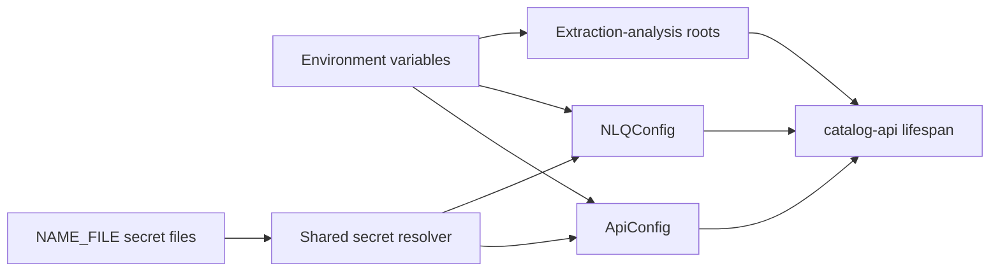

# catalog-api configuration

This reference covers only configuration read by the `catalog-api` repository. The
[`deployment` repository](https://github.com/groovemap-music/deployment) owns Compose wiring,
production secret creation, service discovery, and cross-service defaults.



## Required settings

The API fails fast when any required value is missing.

| Variable | Purpose |
| --- | --- |
| `POSTGRES_HOST` | PostgreSQL host or `host:port` |
| `POSTGRES_USERNAME` | PostgreSQL login |
| `POSTGRES_PASSWORD` | PostgreSQL password |
| `POSTGRES_DATABASE` | PostgreSQL database |
| `JWT_SECRET_KEY` | HS256 signing secret; use at least 32 random bytes |
| `NEO4J_HOST` | Neo4j host or full Bolt URI |
| `NEO4J_USERNAME` | Neo4j login |
| `NEO4J_PASSWORD` | Neo4j password |

Every secret read through the shared runtime also accepts a file path named `<NAME>_FILE`.
For example, set `POSTGRES_PASSWORD_FILE=/run/secrets/postgres_password` instead of putting the
password in the environment. Do not set both forms to conflicting values.

## Connections and pools

| Variable | Default | Purpose |
| --- | --- | --- |
| `POSTGRES_PORT` | `5432` | PostgreSQL port when it is not embedded in `POSTGRES_HOST` |
| `POSTGRES_POOL_MIN_SIZE` | `2` | Minimum API pool size |
| `POSTGRES_POOL_MAX_SIZE` | `8` | Maximum API pool size |
| `NEO4J_PORT` | `7687` | Bolt port used when `NEO4J_HOST` is a bare host; ignored for a full URI |
| `NEO4J_TLS_ENABLED` | `false` | Enable Bolt TLS for a host without a TLS URI scheme |
| `NEO4J_TLS_VERIFY` | `true` | Verify the Bolt certificate when TLS is enabled |
| `VALKEY_HOST` | `localhost` | Valkey hostname; supply a host, not a URL |
| `VALKEY_PORT` | `6379` | Valkey port |
| `VALKEY_PASSWORD` | unset | Optional plain password; empty disables authentication when no nonempty password-file path is set |
| `VALKEY_PASSWORD_FILE` | unset | Nonempty file path takes precedence over the plain password; unreadable files fail closed |

The API uses valkey-py with its libvalkey parser and constructs a `valkey://` URL for
database 0 from these component settings. Passwords are percent-quoted and never
printed in the startup log; that log reports the host only.

Use `neo4j+s://...` in `NEO4J_HOST` for a managed Neo4j endpoint that already expresses its
TLS policy. Deployment-specific certificate and network guidance belongs in `deployment`.

## Authentication and public URLs

| Variable | Default | Purpose |
| --- | --- | --- |
| `JWT_ALGORITHM` | `HS256` | Only `HS256` is accepted |
| `JWT_EXPIRE_MINUTES` | `30` | Access-token lifetime |
| `DISCOGS_USER_AGENT` | `GrooveMap-catalog-api/1.0 +https://github.com/groovemap-music/catalog-api` | Discogs request identity |
| `DISCOGS_OAUTH_CALLBACK_URL` | unset | Registered public Discogs callback; unset retains the OOB flow |
| `APP_BASE_URL` | `http://localhost:8006` | Public browser origin used in email links |
| `CORS_ORIGINS` | unset | Comma-separated allowed origins; unset allows only the local development origins `http://localhost:3000` and `http://localhost:8003` |
| `ENCRYPTION_MASTER_KEY` | unset | HKDF input for OAuth and TOTP encryption |

`APP_BASE_URL` is a user-facing origin, not an internal API address. Set it to the real HTTPS
origin in production so password-reset links do not point at localhost.

## Repository integrations

| Variable | Default | Purpose |
| --- | --- | --- |
| `INSIGHTS_INTERNAL_SECRET` | unset | Shared secret for the internal Analytics router; unset fails closed |
| `INSIGHTS_BASE_URL` | `http://insights:8008` | Base URL of the analytics-engine that `/api/insights/*` requests are proxied to; a trailing slash is ignored |
| `RESEND_API_KEY` | unset | Optional transactional-email API key |
| `RESEND_SENDER_EMAIL` | `noreply@groovemap.music` | Transactional-email sender |
| `RESEND_SENDER_NAME` | `GrooveMap` | Transactional-email display name |
| `EXTRACTOR_DISCOGS_HOST` | `EXTRACTOR_HOST` or `extractor-discogs` | Host of the Discogs producer's trigger and health endpoints |
| `EXTRACTOR_DISCOGS_HEALTH_PORT` | `EXTRACTOR_HEALTH_PORT` or `8000` | Port of the Discogs producer's trigger and health endpoints |
| `EXTRACTOR_MUSICBRAINZ_HOST` | `extractor-musicbrainz` | Host of the MusicBrainz producer's trigger and health endpoints |
| `EXTRACTOR_MUSICBRAINZ_HEALTH_PORT` | `8000` | Port of the MusicBrainz producer's trigger and health endpoints |
| `EXTRACTOR_HOST` | unset | Deprecated Discogs fallback for `EXTRACTOR_DISCOGS_HOST`; remove after one release |
| `EXTRACTOR_HEALTH_PORT` | unset | Deprecated Discogs fallback for `EXTRACTOR_DISCOGS_HEALTH_PORT`; remove after one release |
| `DISCOGS_DATA_ROOT` | unset | Mounted Discogs validation-result root exposed by extraction-analysis routes |
| `MUSICBRAINZ_DATA_ROOT` | unset | Mounted MusicBrainz validation-result root exposed by extraction-analysis routes |
| `RABBITMQ_HOST` | `rabbitmq` | RabbitMQ AMQP host; used only for DLQ purge |
| `RABBITMQ_PORT` | `5672` | RabbitMQ AMQP port; used only for DLQ purge |
| `RABBITMQ_USERNAME` | `groovemap` | RabbitMQ AMQP login; used only for DLQ purge |
| `RABBITMQ_PASSWORD` | `groovemap` | RabbitMQ AMQP password; used only for DLQ purge |
| `IDENTITY_AUTO_REATTACH_ENABLED` | `false` | Run the catalog re-attachment then the `gm_id` projection after each completed Discogs extraction (see `api/README.md`) |
| `IDENTITY_AUTO_REATTACH_INTERVAL` | `300` | How often that watcher polls `loader_extraction_latch`, in seconds |
| `IDENTITY_LEDGER_REFRESH_ENABLED` | `false` | Refresh the Identity Ledger's precomputed views after loads, by polling the sources' write counts; re-attachment and backfill runs refresh inline either way (see `api/README.md`, "Keeping the Identity Ledger Fresh") |
| `IDENTITY_LEDGER_REFRESH_INTERVAL` | `300` | How often that poll runs, in seconds |
| `IDENTITY_LEDGER_REFRESH_QUIET` | `600` | Seconds the sources must stop changing before the poll refreshes |
| `IDENTITY_LEDGER_MAX_STALENESS` | `21600` | Seconds after the last refresh at which the poll refreshes changed sources even while writes continue |
| `SIMILAR_ARTISTS_PRECOMPUTED_ENABLED` | `false` | Serve `/api/recommend/similar/artist/{id}` from the current release of the precomputed `artist_similar_artists` lists; the heuristic path serves whenever this is off or no list is usable (see `docs/similar-artists-precomputed.md`) |
| `SIMILAR_ARTISTS_FUSION_ALPHA` | `0.8` | Weight on the embedding cosine in `alpha * cosine + (1 - alpha) * heuristic`; `1.0` ranks by the precomputed list alone. Must be within 0 and 1 |

The internal Analytics secret and RabbitMQ credentials support their corresponding `_FILE`
forms. [`discogs-ingestion`](https://github.com/groovemap-music/discogs-ingestion) and
[`musicbrainz-ingestion`](https://github.com/groovemap-music/musicbrainz-ingestion) independently
own source acquisition and the result trees mounted at the two data roots. The administrative
extraction trigger dispatches by `source` to the per-source `EXTRACTOR_<SOURCE>_HOST` and
`EXTRACTOR_<SOURCE>_HEALTH_PORT` endpoints. The legacy `EXTRACTOR_HOST`/`EXTRACTOR_HEALTH_PORT`
pair is honored as the Discogs fallback for one release; it never affects MusicBrainz. Catalog
API does not schedule or coordinate ingestion.

## Snapshots, NLQ, and runtime

| Variable | Default | Purpose |
| --- | --- | --- |
| `SNAPSHOT_TTL_DAYS` | `28` | Snapshot lifetime |
| `SNAPSHOT_MAX_NODES` | `100` | Maximum nodes per snapshot |
| `SNAPSHOT_MAX_PAYLOAD_BYTES` | `65536` | Maximum serialized snapshot size |
| `SNAPSHOT_MAX_PER_USER` | `50` | Maximum retained snapshots per user |
| `NLQ_ENABLED` | `false` | Enable natural-language queries |
| `NLQ_API_KEY` | unset | Provider key; `NLQ_API_KEY_FILE` is supported |
| `NLQ_MODEL` | `claude-sonnet-4-20250514` | Provider model identifier |
| `NLQ_MAX_ITERATIONS` | `5` | Tool-loop limit |
| `NLQ_MAX_QUERY_LENGTH` | `500` | Input length limit |
| `NLQ_CACHE_TTL` | `3600` | NLQ cache lifetime in seconds |
| `NLQ_RATE_LIMIT` | `10/minute` | Per-client rate limit |
| `LOG_LEVEL` | `INFO` | API and server log level |
| `ENVIRONMENT` | `development` | Deployment name written as the `environment` field of every log record |
| `LOG_FILE` | `/logs/api.log` | Log file path; empty disables the file. An unwritable path falls back to console logging with one warning |
| `PROFILING_LOG_FILE` | `/logs/profiling.log` | Query-profiling log path; empty disables it. An unwritable path logs one warning and profiling output is dropped (no console fallback) |
| `LOG_FILE_MAX_BYTES` | `104857600` | Size in bytes at which the log file rolls over |
| `LOG_FILE_BACKUP_COUNT` | `5` | Number of rotated log file backups retained |
| `FORWARDED_ALLOW_IPS` | `172.20.0.0/16` | Trusted proxy addresses for Uvicorn |
| `GROOVEMAP_SOURCE_REVISION` | build revision | Exact source revision linked from OpenAPI metadata |

See the [logging guide](logging-guide.md) for the API's logging behavior.

## OpenTelemetry metrics and traces

The API pushes metrics and spans over OTLP HTTP/protobuf and exposes no Prometheus scrape
endpoint of its own. Only the standard OpenTelemetry variables are read, all of them by the
SDK inside `groovemap-runtime`; there is no GrooveMap-specific telemetry variable. With
`OTEL_EXPORTER_OTLP_ENDPOINT` unset the service installs a no-op meter provider and a no-op
tracer provider and runs exactly as it did before, so telemetry can never fail startup or
change behavior. The two signals are independent: metrics can export while tracing is off,
and the other way round. Only the endpoint is shared.

| Variable | Default | Purpose |
| --- | --- | --- |
| `OTEL_EXPORTER_OTLP_ENDPOINT` | unset | Collector base URL, for example `http://otel-collector:4318`; unset disables export |
| `OTEL_EXPORTER_OTLP_METRICS_ENDPOINT` | falls back to the base URL | Metrics-only endpoint override |
| `OTEL_EXPORTER_OTLP_TRACES_ENDPOINT` | falls back to the base URL | Traces-only endpoint override |
| `OTEL_METRICS_EXPORTER` | `otlp` | `none` forces metric export off |
| `OTEL_TRACES_EXPORTER` | `otlp` | `none` forces span export off; no span is created at all |
| `OTEL_TRACES_SAMPLER` | `parentbased_traceidratio` | Sampler name; a sampled parent always keeps its children |
| `OTEL_TRACES_SAMPLER_ARG` | `1.0` | Sampling ratio; deployment keeps `1.0` in dev and turns it down in production |
| `OTEL_SDK_DISABLED` | `false` | `true` makes the SDK itself a no-op |
| `OTEL_METRIC_EXPORT_INTERVAL` | `60000` | Push interval in milliseconds; the OpenTelemetry SDK default |
| `OTEL_SERVICE_NAME` | `api` | `service.name`; the compose service key |
| `OTEL_RESOURCE_ATTRIBUTES` | unset | Extra resource attributes, for example `service.namespace=groovemap,deployment.environment.name=dev` |

Trace context travels as W3C `traceparent`. Every outbound HTTP call the service makes
inside a request or a sync carries it, so analytics-engine, Discogs, and Anthropic calls
join the trace that caused them.

The API records these metrics. `service.version` is the packaged version, and no attribute
ever carries an identifier, a cache key, or free text.

| Metric | Attributes |
| --- | --- |
| `http.server.request.duration` | `http.request.method`, `http.route` (the templated path), `http.response.status_code`; `/health` and `/ready` are excluded |
| `http.client.request.duration` | `http.request.method`, `server.address`, `http.response.status_code`; covers analytics-engine, Discogs, and Anthropic |
| `db.client.operation.duration` | `db.system.name` (`postgresql`, `neo4j`, or `valkey`), `db.operation.name`, `error.type` on failure |
| `groovemap.api.sync.duration` | `outcome` (`completed`, `failed`, `cancelled`) |
| `groovemap.api.cache` | `outcome` (`hit`, `miss`), `cache` (the logical Valkey cache) |
| `groovemap.api.cache.write_failures` | `cache` (the logical Valkey cache), `error.type` (the exception class) |
| `groovemap.api.nlq.requests` | `outcome` (`success`, `cached`, `error`, `invalid`, `unavailable`) |
| `groovemap.api.activity_events` | `event_type` (the version 1 event vocabulary, plus `impression`) |
| `groovemap.api.activity_failures` | `outcome` (`duplicate`, `invalid`, `not_configured`, `no_native_id`, `no_subject`, `write_failed`) |
| `groovemap.api.identity_ledger.refreshes` | `trigger` (`reattach`, `backfill`, `poll`), `outcome` (`success`, `failed`) |

Cache writes are best-effort: a failed write never fails the request. Each one increments
`groovemap.api.cache.write_failures` and logs a `Cache write failed` warning, at most once a
minute per logical cache, carrying a `suppressed` count of the failures folded into the quiet
period. A full or unreachable Valkey is therefore visible directly rather than only through
the `ValkeyMemoryHigh` alert and a falling hit ratio.

PostgreSQL and Neo4j report `db.client.operation.duration` through the `groovemap-runtime`
resilient wrappers. Valkey is reached without one, so its client is wrapped at startup and
reports the same metric itself. The collector, VictoriaMetrics, Grafana dashboards, and the
canonical metric catalog are owned by the
[`deployment` repository](https://github.com/groovemap-music/deployment).

### Runtime metrics

The `otel` extra installs the system-metrics instrumentation, so `setup_telemetry` reports
the process view with no call site in this service. Only process-scoped instruments are
collected: a host is scraped once by node-exporter, and a service reporting host numbers
would multiply them by however many containers share the machine.

| Instrument | Attributes |
| --- | --- |
| `process.cpu.time` | `type` (`user`, `system`) |
| `process.cpu.utilization` | none |
| `process.memory.usage` | none |
| `process.memory.virtual` | none |
| `process.thread.count` | none |
| `process.open_file_descriptor.count` | none |
| `process.context_switches` | `type` (`involuntary`, `voluntary`) |
| `cpython.gc.collections` | `generation`, `cpython.gc.generation` |
| `groovemap.runtime.event_loop.lag` | none |

`groovemap.runtime.event_loop.lag` is the one runtime signal no library provides. The
FastAPI lifespan starts the sampler with `start_event_loop_monitor()` once there is a
running loop, and it records how much longer each one-second sleep actually took, which is
the time the loop could not run a ready callback. It is not started when metrics are not
being exported, and `shutdown_telemetry()` cancels it on the way out.

### Spans

Every span name is low-cardinality, and a span attribute never carries an identifier, a
statement, a file name, or free text. A failure sets status `ERROR` with `error.type` only:
no message, no stack trace, no span event carrying a payload.

| Span | Kind | Attributes | Opened by |
| --- | --- | --- | --- |
| `{method} {http.route}` | `SERVER` | `http.request.method`, `http.route`, `http.response.status_code` | the FastAPI instrumentation; `/health` and `/ready` are excluded |
| `{method}` | `CLIENT` | `http.request.method`, `server.address`, `http.response.status_code` | the httpx instrumentation, for analytics-engine, Discogs, and Anthropic |
| `{db.operation.name} {db.system.name}` | `CLIENT` | `db.system.name`, `db.operation.name`, `error.type` on failure | the `groovemap-runtime` PostgreSQL and Neo4j wrappers |
| `api.sync` | `INTERNAL` | `outcome` (`completed`, `failed`, `cancelled`) | `run_full_sync`, one per Discogs collection and wantlist sync |
| `api.nlq` | `INTERNAL` | `outcome` (`success`, `cached`, `error`, `invalid`, `unavailable`) | the `/api/nlq/query` endpoint, one per request in both the JSON and the streaming mode |

`api.sync` and `api.nlq` are the two domain root spans this service owns; every other span
above arrives from an instrumentor or a shared wrapper without a call site here. Their
`outcome` is written by the same call that records the matching metric, so a span and its
metric can never disagree about how the operation ended. Span metrics (call counts and
durations per span name) are derived by the collector, never emitted by this service.

## Minimal local example

Use disposable local credentials only; do not commit this file.

```bash
POSTGRES_HOST=localhost
POSTGRES_USERNAME=groovemap
POSTGRES_PASSWORD=local-only
POSTGRES_DATABASE=groovemap
NEO4J_HOST=localhost
NEO4J_USERNAME=neo4j
NEO4J_PASSWORD=local-only
VALKEY_HOST=localhost
JWT_SECRET_KEY=replace-with-at-least-32-random-bytes
DISCOGS_USER_AGENT="GrooveMap-catalog-api/1.0 +https://github.com/groovemap-music/catalog-api"
APP_BASE_URL=http://localhost:8006
LOG_LEVEL=INFO
```

The test suite uses fakes and does not require live PostgreSQL, Neo4j, Valkey, RabbitMQ, Discogs,
Anthropic, or Resend connections.

## Operator-owned credentials

Discogs application credentials are stored in PostgreSQL rather than environment variables.
Use the packaged `catalog-setup` CLI from the deployed API container; its output masks values.
The [API service guide](../api/README.md#operator-setup) documents that operation.

For runtime secret mounts, container topology, and environment promotion, follow the
[`deployment` documentation](https://github.com/groovemap-music/deployment/tree/main/docs).
