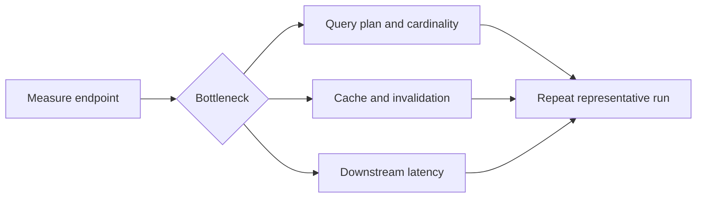

# catalog-api performance

This guide covers performance work owned by `catalog-api`: request measurement, query design,
caching, timeouts, and the `catalog-api-performance` runner. Environment sizing and repeatable
stack orchestration belong to
[`deployment`](https://github.com/groovemap-music/deployment).



## Repository gates

```bash
just test
just coverage
just check
just performance-image
```

`just test` and its `just coverage` alias execute the test suite once and write `coverage.xml`.
`just check` is the full deterministic repository gate and uses fakes; it does not run the live
performance workload. `just performance-image` builds the repository-named local runner; it does
not start databases, publish an image, or alter a deployment. Run the image against a disposable,
representative stack provisioned by `deployment`.

The runner configuration and full endpoint matrix are documented in
[`performance/README.md`](../performance/README.md). Record the catalog-api revision, promoted
schema and data-image revisions, dataset identity, warm/cold cache state, iteration count, and
host resources with every result.

## Measurement rules

1. Establish a baseline before changing code.
1. Measure warm and cold paths separately.
1. Use p95 and error count in addition to averages.
1. Compare identical dataset and dependency revisions.
1. Profile one query family at a time before changing indexes or caches.
1. Preserve result JSON and logs outside the repository.

Request latency is reported only through OpenTelemetry: the FastAPI instrumentation records
`http.server.request.duration` keyed on the templated route (`http.route`), so identifier path
segments never become an unbounded label set. Health, readiness, and metrics paths are excluded,
and nothing is exported without `OTEL_EXPORTER_OTLP_ENDPOINT`. See the
[OpenTelemetry configuration](configuration.md#opentelemetry-metrics-and-traces).

## API-owned optimization patterns

### Bound graph work

Use explicit relationship types and directions, index-backed entry points, pagination, and
server-side query timeouts. Batch related lookups rather than issuing one query per candidate.
The detailed query patterns and their measured history are in
[query performance optimizations](query-performance-optimizations.md).

### Bound SQL work

Apply a per-source limit before merging ranked full-text results. Execute independent count and
facet queries concurrently only when their combined database budget remains bounded. The API pool
defaults to a minimum of 2 and maximum of 8; deployment may override those values within its
global database budget.

### Cache stable results

The API owns cache keys, TTLs, and invalidation for its responses. Current examples include:

| Result | Cache behavior |
| --- | --- |
| Genre tree | Built in the background and stored (memory + Valkey); no scan on the request path |
| Explore and trends | Valkey cache for stable imported data |
| Recommendations and label DNA | Valkey cache with bounded TTL |
| Search | Valkey cache after bounded PostgreSQL queries |
| Data completeness | Six-hour Valkey cache for expensive aggregate scans |
| User timeline and collection gaps | Bounded in-process caches |

Cache correctness is part of the API contract: invalidation follows successful writes, a failed
cache should not turn an authorization failure into success, and caches must remain bounded.

## Cross-repository performance ownership

Changes outside the request path must be made in their owning repositories:

- Index and constraint definitions:
  [`database-schema`](https://github.com/groovemap-music/database-schema)
- Discogs graph denormalization:
  [`discogs-graph-enricher`](https://github.com/groovemap-music/discogs-graph-enricher)
- Discogs relational loading:
  [`discogs-sql-loader`](https://github.com/groovemap-music/discogs-sql-loader)
- MusicBrainz graph enrichment:
  [`musicbrainz-graph-enricher`](https://github.com/groovemap-music/musicbrainz-graph-enricher)
- MusicBrainz relational loading:
  [`musicbrainz-sql-loader`](https://github.com/groovemap-music/musicbrainz-sql-loader)
- Precomputed analytics scheduling and storage:
  [`analytics-engine`](https://github.com/groovemap-music/analytics-engine)
- Runtime resource limits, networks, and monitoring:
  [`deployment`](https://github.com/groovemap-music/deployment)

Catalog API changes may consume a promoted contract from those repositories, but they must not
silently rewrite another repository's schema, image, or runtime configuration.

## Review checklist

- Representative endpoint and dataset are identified.
- Baseline and candidate use identical promoted dependencies.
- Query counts, cardinality, p95, and error count improve or remain within budget.
- New caches have bounded size or TTL and tested invalidation.
- New database work has explicit pagination or timeout behavior.
- The default test suite remains isolated from live services.
- Performance results do not contain credentials, tokens, or private URLs.


## Autocomplete ranking

Artist, label, genre, style and person autocomplete (`gm-catalog-api-4wgh`, audit H15) send `{limit}` to the Lucene
fulltext procedure, so only the best `limit` names are scored and returned (`the*`: 163 ms before, 3 to 7 ms warm).

The typed text is cut into tokens the way the index analyzer cuts names (letters and digits; an apostrophe or dot
inside a word stays in it), so `jay-z` is `jay` and `z`, `ac/dc` is `ac` and `dc`, and `d'angelo` is one token.
Every token is required and the last is a prefix (`jay AND z*`): only names holding all of them match. The old query
sent `jay-z` to Lucene as one escaped prefix, which matched nothing, so punctuated names could not be found at all.
On lux: `jay-z` 79 matches (Jay-Z first), `ac/dc` 10 (AC/DC first), `d'angelo` 412 (D'Angelo first).

Prefix terms are constant-score in Lucene, so the query adds boosts that decide who is "best":

* two or more tokens: the whole phrase is boosted x100, so a name equal to what was typed outranks longer names that
  merely start with it (`David Bowie` before `David Bowie Tribute`);
* one token: a name containing that whole word is boosted over one that only starts with it.

Every word but the last must now be a whole word; the old query also accepted a prefix there (`david bowie` matched
`Davidson Bowie`). Known limits: Lucene cannot see how well known a name is, so among names with the same score the order
is shorter name, then id (accepted by the operator); names that differ only by punctuation score the same (`David Bowie` and
`David Bowie,`; a name equal to the typed text wins the tie); and a name that repeats the typed word (`The The The`) can
outscore the single word (`The`).
