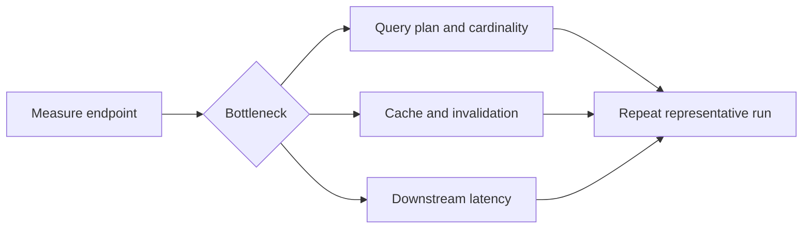

# catalog-api performance

This guide covers performance work owned by `catalog-api`: request measurement, query design,
caching, timeouts, and the `catalog-api-performance` runner. Environment sizing and repeatable
stack orchestration belong to
[`deployment`](https://github.com/groovemap-music/deployment).



## Repository gates

```bash
just test
just coverage
just check
just performance-image
```

`just test` and its `just coverage` alias execute the test suite once and write `coverage.xml`.
`just check` is the full deterministic repository gate and uses fakes; it does not run the live
performance workload. `just performance-image` builds the repository-named local runner; it does
not start databases, publish an image, or alter a deployment. Run the image against a disposable,
representative stack provisioned by `deployment`.

The runner configuration and full endpoint matrix are documented in
[`performance/README.md`](../performance/README.md). Record the catalog-api revision, promoted
schema and data-image revisions, dataset identity, warm/cold cache state, iteration count, and
host resources with every result.

## Measurement rules

1. Establish a baseline before changing code.
1. Measure warm and cold paths separately.
1. Use p95 and error count in addition to averages.
1. Compare identical dataset and dependency revisions.
1. Profile one query family at a time before changing indexes or caches.
1. Preserve result JSON and logs outside the repository.

Request latency is reported only through OpenTelemetry: the FastAPI instrumentation records
`http.server.request.duration` keyed on the templated route (`http.route`), so identifier path
segments never become an unbounded label set. Health, readiness, and metrics paths are excluded,
and nothing is exported without `OTEL_EXPORTER_OTLP_ENDPOINT`. See the
[OpenTelemetry configuration](configuration.md#opentelemetry-metrics-and-traces).

## API-owned optimization patterns

### Bound graph work

Use explicit relationship types and directions, index-backed entry points, pagination, and
server-side query timeouts. Batch related lookups rather than issuing one query per candidate.
The detailed query patterns and their measured history are in
[query performance optimizations](query-performance-optimizations.md).

### Bound SQL work

Apply a per-source limit before merging ranked full-text results. Execute independent count and
facet queries concurrently only when their combined database budget remains bounded. The API pool
defaults to a minimum of 2 and maximum of 8; deployment may override those values within its
global database budget.

### Cache stable results

The API owns cache keys, TTLs, and invalidation for its responses. Current examples include:

| Result | Cache behavior |
| --- | --- |
| Genre tree | Built in the background and stored (memory + Valkey); no scan on the request path |
| Explore and trends | Valkey cache for stable imported data |
| Recommendations and label DNA | Valkey cache with bounded TTL |
| Search | Valkey cache after bounded PostgreSQL queries |
| Data completeness | Six-hour Valkey cache for expensive aggregate scans |
| User timeline and collection gaps | Bounded in-process caches |

Cache correctness is part of the API contract: invalidation follows successful writes, a failed
cache should not turn an authorization failure into success, and caches must remain bounded.

## Cross-repository performance ownership

Changes outside the request path must be made in their owning repositories:

- Index and constraint definitions:
  [`database-schema`](https://github.com/groovemap-music/database-schema)
- Discogs graph denormalization:
  [`discogs-graph-enricher`](https://github.com/groovemap-music/discogs-graph-enricher)
- Discogs relational loading:
  [`discogs-sql-loader`](https://github.com/groovemap-music/discogs-sql-loader)
- MusicBrainz graph enrichment:
  [`musicbrainz-graph-enricher`](https://github.com/groovemap-music/musicbrainz-graph-enricher)
- MusicBrainz relational loading:
  [`musicbrainz-sql-loader`](https://github.com/groovemap-music/musicbrainz-sql-loader)
- Precomputed analytics scheduling and storage:
  [`analytics-engine`](https://github.com/groovemap-music/analytics-engine)
- Runtime resource limits, networks, and monitoring:
  [`deployment`](https://github.com/groovemap-music/deployment)

Catalog API changes may consume a promoted contract from those repositories, but they must not
silently rewrite another repository's schema, image, or runtime configuration.

## Review checklist

- Representative endpoint and dataset are identified.
- Baseline and candidate use identical promoted dependencies.
- Query counts, cardinality, p95, and error count improve or remain within budget.
- New caches have bounded size or TTL and tested invalidation.
- New database work has explicit pagination or timeout behavior.
- The default test suite remains isolated from live services.
- Performance results do not contain credentials, tokens, or private URLs.

## Label DNA and similar labels

`/api/label/{id}/dna` and `/api/label/{id}/similar` (`gm-catalog-api-j4ml`, audit H9; both cache for 24 h, so this is the cold path):

* **Identity** reads `Label.release_count` and `Label.artist_count` (the enricher's; equal to the live counts for Columbia) and counts
  live only for a label that lacks them. Label 1818: 9.37M db hits and 1.7 s live, 5 hits stored.
* **Decades and active years** come from one read of the label's per-year release counts (a release has one year, so the counts
  add). The two reads were the same scan twice (Columbia 1.05M hits each).
* **Genres and styles** come from one pass over the label's releases, grouped by kind (Columbia: 8.5M hits and 39 MB, against 7.05M
  plus 7.02M separately).
* **Similar labels** take a label's top five styles from `(:Label)-[h:HAS_STYLE {release_count}]->(:Style)` and, for every other
  label in each style, `h.release_count`: edge reads instead of a scan of every release in the style (54.7M hits and 28.3 s live,
  driven by the size of the styles). Nothing is capped per style: the live form had no cap either. The edges are trusted only
  when the enricher's completeness marker says its sweep finished: the newest `ExtractionCompletion` node is maintained
  (`maintained_at` set) and has `stats_version >= 1`. No node, a null `stats_version` or an unmaintained node (a new dump is
  importing, or a sweep stopped part way) means the live form runs and returns the same candidates; a partly filled or stale edge
  set would otherwise drop labels and under-count `total_shared`. A real-Neo4j test covers a partial set under each marker state.
  **Ties are now broken deterministically**: the top five styles tie-break by style name and the top 100 candidates by label id
  (the old statement left both to the planner), in both forms, so the candidate lists can differ from an old response only where
  the old order among ties was arbitrary. There is no label evaluation set (the evaluation harness is artist-only), so the
  quality check is that candidates, totals and therefore cosine scores are identical to the live form's.
* Candidate release counts read `Label.release_count` and count live where it is absent.

Measured on lux before the enricher has written the new properties: the identity and year reads above. The similar-label figure
(`< 10M` hits) can only be measured once `HAS_STYLE` exists. The 40% reduction for Columbia's DNA is about 33% from these changes
(identity 6.65M, genre and style 5.5M, years 1.05M of 39.9M); the format and media reads are unchanged.


## Network cluster

`/api/network/cluster/{artist_id}` (`gm-catalog-api-575h`, audit H6) ranks neighbours by shared releases, cuts to `limit`, and only
then reads each one's primary genre. The old statement built every neighbour's genre histogram first: one Various co-credit cost
1.53M releases and Bowie took 29.6 s and 37.5M db hits. Ties in shared releases now break by artist id.

The primary genre is `Artist.primary_genre` (written by the enricher: the genre on most of the artist's releases, a tie to the
alphabetically first genre, absent when the artist has no genre). Where it is absent the genre is computed live for that ranked
neighbour with the same rule, so the answer is the same before and after the enricher's first pass; only the cost differs. On lux
(no artist has the property yet): ranking alone is 0.29M hits for Bowie and 0.54M for The Beatles (75 and 101 ms); with the live
fallback for all 50 neighbours Bowie is 3.6M hits (0.5 s) and The Beatles 31M (3.4 s), against 37.5M for Bowie before.
